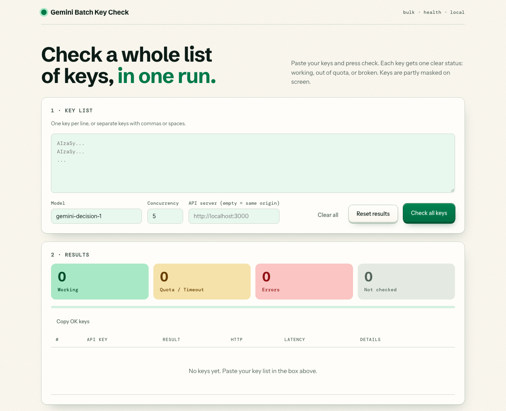

# Check a list of Gemini API keys locally

I built this tool to test a batch of Gemini API keys in one run without installing any packages. Paste your keys into the browser, and a local Node server checks each one and groups the results by status.



## Why a local server

The web page sends each check to a local Node server instead of calling Google directly from the browser. That keeps your keys on your machine and avoids third-party key-checker sites.

Everything runs with Node 18 or newer and the built-in `http`, `fs`, `path`, and `fetch` APIs. There is no `package.json` and nothing to install.

## Run it in two steps

Start the server from the repo folder:

```bash
node server.js
```

Open `http://localhost:3000` in your browser. Set the `PORT` environment variable if port `3000` is already busy.

1. Paste your keys into the box, separated by new lines, commas, semicolons, or spaces.
2. Adjust **Model** (defaults to `gemini-decision-1`) and **Concurrency** (1 to 20, defaults to `5`).
3. Click **Check all keys**.
4. Click any summary tile (**Working**, **Quota / Timeout**, **Errors**, **Not checked**) to filter the table. Click **Copy OK keys** to copy every working key.

Each row also has a **Check** button to retest a single key. Use **Reset results** to clear statuses while keeping your key list, or **Clear all** to wipe both.

## How each check works

The browser sends each key to `POST /api/check` on the local server. The server calls `https://generativelanguage.googleapis.com/v1beta/decisions` with the `x-goog-api-key` header and a small `Ping` payload.

Each request has a 20-second timeout. The server maps the HTTP response to one status badge:

| Status | Meaning |
|---|---|
| `OK` | Request succeeded (HTTP 2xx) |
| `Out of quota (429)` | Rate limit or quota exhausted |
| `Timeout` | No response within 20 seconds |
| `Invalid key` | `API_KEY_INVALID` or invalid key message |
| `Blocked (403)` | Key lacks permission or is restricted |
| `Model not found` | HTTP 404 for the selected model |
| `Error` | Any other network or HTTP error |

The UI masks keys longer than 12 characters on screen. It shows only the first 8 and last 4 characters.

## Known limits

By default, the server calls the `v1beta/decisions` endpoint with `gemini-decision-1`. Keys that only work on other endpoints may return `Model not found` unless you edit `server.js`. Nothing is saved to disk, and refreshing the page clears the table.

Clone the repo, run `node server.js`, and paste your key list to see which keys still work.
